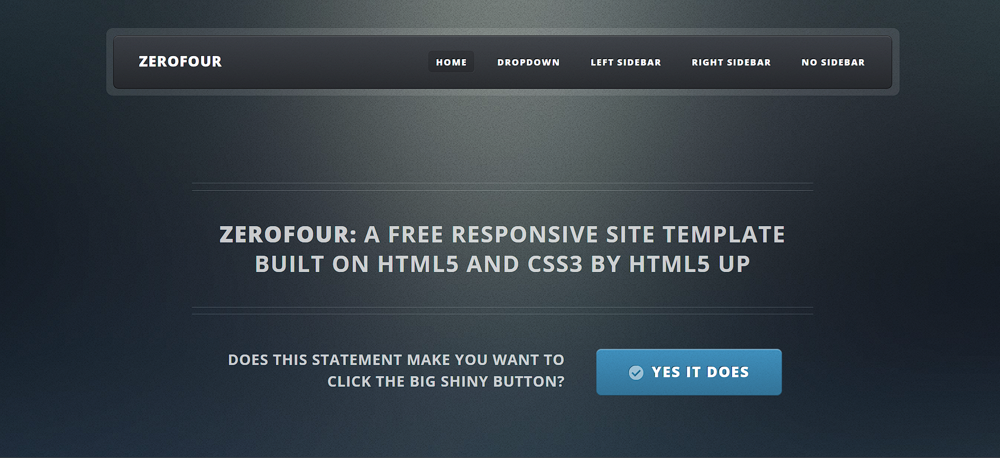
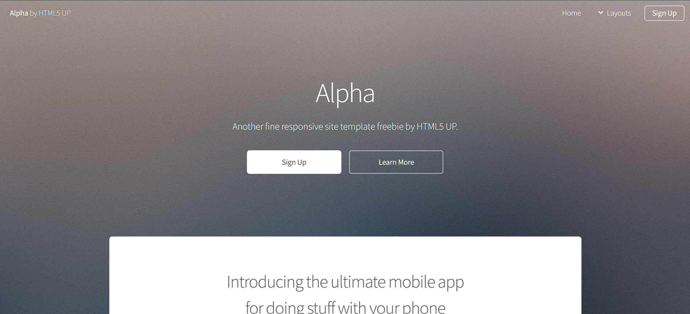
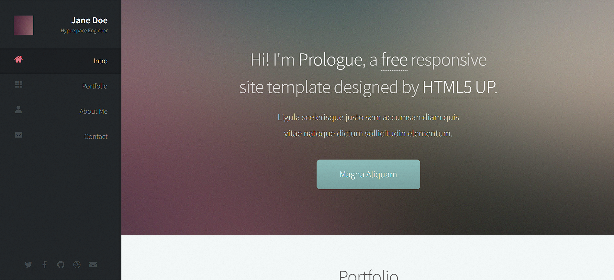

# Arte en el Cerro — Landing Page

## 1. Análisis

### 1.1. Contexto del proyecto


### 1.1. Contexto del proyecto

Arte en el Cerro es una iniciativa cultural desarrollada
por ESPOL en conjunto con Segura EP y la comunidad del
Cerro del Carmen, vinculada al propósito de acercar el
arte a la ciudadanía y fortalecer la convivencia comunitaria.

La iniciativa comenzó el 21 de julio de 2026 y contempla
actividades artísticas el primer viernes de cada mes,
a las 17:00, bajo la idea del arte como herramienta
de transformación social.

Esta landing page tiene como protagonista la cuarta
jornada, realizada el 2 de octubre de 2026. Participaron
el Coro ESPOL, el Grupo de Teatro ESPOL y la invitada
especial Elena Erazo. Debido a las lluvias, el encuentro
se desarrolló en el Aula Magna de ESPOL Campus Las Peñas,
en Guayaquil.

El sitio también presenta un archivo visual de los encuentros
del 21 de julio, 7 de agosto y 4 de septiembre de 2026.

La página se desarrolló como parte de un proyecto académico,
utilizando la plantilla ZeroFour de HTML5 UP y personalizando
su contenido, diseño, navegación y componentes interactivos.
Se incorporaron fotografías, videos, información del evento,
un mapa de ubicación y enlaces institucionales.

### 1.2. Organización del contenido

| Sección | Propósito | Contenido implementado |
|---|---|---|
| Inicio | Presentar la identidad del evento. | Logotipo, fotografía del Cerro del Carmen y presentación general. |
| Sobre el evento | Explicar el propósito cultural. | Contexto, fotografía real, información y animación de texto al desplazarse. |
| Programación artística | Presentar a los participantes. | Coro ESPOL, Grupo de Teatro ESPOL y Elena Erazo, con fotografías y descripciones. |
| Galería | Mostrar los momentos del evento. | Videoteca de tres presentaciones del 2 de octubre, archivo fotográfico de julio, agosto y septiembre, y Reel promocional de Instagram |
| Información | Comunicar los datos prácticos. | Fecha, hora anunciada, acceso libre y sede, con efecto de profundidad. |
| Ubicación | Identificar el espacio del encuentro. | Aula Magna, referencia de dirección, mapa de Google y enlace para consultar la ubicación. |
| Contacto y redes | Facilitar el acceso a canales institucionales. | Canales institucionales, navegación inferior y formulario de contacto demostrativo |

La estructura implementada responde a los objetivos del
proyecto y permite actualizar posteriormente las fotografías
y otros contenidos autorizados por los organizadores.

### 1.3. Necesidades identificadas

- **Centralización:** reunir la información relevante del evento en un solo sitio.
- **Organización:** distribuir el contenido en secciones claras.
- **Comunicación:** facilitar la consulta de ubicación y novedades.
- **Presentación visual:** mostrar imágenes relacionadas con las actividades artísticas.
- **Adaptabilidad:** permitir la visualización desde computadoras y dispositivos móviles.

## 2. Planificación

### 2.1. Plantillas candidatas

Se seleccionaron tres plantillas gratuitas de HTML5 UP:

- **ZeroFour**

  

- **Alpha**

  

- **Prologue**

  

### 2.2. Comparación de las plantillas

| Criterio | ZeroFour | Alpha | Prologue |
|---|---|---|---|
| Estructura | Diseño flexible con distintas áreas de contenido. | Presentación mediante bloques informativos y páginas complementarias. | Página única organizada en secciones verticales. |
| Navegación | Menú de navegación con opciones de personalización. | Navegación convencional entre secciones y páginas. | Barra lateral con enlaces a las secciones. |
| Diseño | Versátil para combinar texto, imágenes y bloques informativos. | Limpio y orientado a presentar una propuesta de manera directa. | Minimalista y centrado en la presentación visual. |
| Adaptabilidad | Diseño adaptable a diferentes tamaños de pantalla. | Diseño adaptable a computadoras y dispositivos móviles. | Diseño adaptable con navegación lateral. |
| Personalización | Permite modificar la distribución y los componentes. | Facilita la modificación de bloques y contenidos. | Facilita la edición de una página única. |
| Adecuación al evento | Alta: permite combinar información general, programación, galería y ubicación. | Alta: apropiada para presentar información breve y directa. | Media-alta: apropiada para una presentación visual y secuencial. |

La comparación se basa en las características de las plantillas originales y en su adecuación a las necesidades del proyecto.

### 2.3. Selección y justificación de ZeroFour

El equipo seleccionó **ZeroFour** como plantilla base para desarrollar la landing page de Arte en el Cerro.

La elección se justifica por su flexibilidad para organizar diferentes tipos de contenido en un mismo sitio. El proyecto requiere presentar información general, actividades artísticas, imágenes, ubicación y medios de contacto. La estructura de ZeroFour proporciona una base adecuada para distribuir estos elementos y personalizarlos según las necesidades del evento.

Además, su diseño adaptable permite desarrollar una interfaz que pueda visualizarse en diferentes dispositivos. Sus archivos HTML, CSS y recursos asociados también facilitan modificar la presentación visual, los textos y las imágenes.

Aunque Alpha ofrece una estructura apropiada para una landing page y Prologue facilita la navegación por una página única, el equipo considera que ZeroFour se ajusta mejor a la variedad de contenido que se desea presentar.

### 2.4. Plan de trabajo

| Actividad | Resultado esperado |
|---|---|
| Revisar la información del evento. | Identificar los datos disponibles y los pendientes de confirmación. |
| Organizar el contenido. | Definir las secciones de la landing page. |
| Comparar las plantillas. | Analizar tres alternativas. |
| Seleccionar ZeroFour. | Documentar la decisión y su justificación. |
| Adaptar HTML y CSS. | Obtener una primera versión de la página. |
| Verificar navegación y adaptabilidad. | Comprobar el funcionamiento en distintos tamaños de pantalla. |
| Publicar el repositorio. | Disponer del código y la documentación en GitHub. |

### 2.5. Organización ágil del trabajo

El desarrollo se dividirá en tareas pequeñas y verificables. Los integrantes coordinarán la distribución de actividades, revisarán los avances y actualizarán el estado de cada tarea conforme se complete.

Se priorizará primero la estructura principal de la página y después la personalización visual, la incorporación del contenido y la validación del funcionamiento.

## 3. Diseño

### 3.1. Estructura de la landing page

La página se organizará en las siguientes secciones:

1. **Inicio:** nombre del evento, descripción e imagen principal.
2. **Sobre el evento:** propósito y descripción de Arte en el Cerro.
3. **Programación artística:** agrupaciones y presentaciones confirmadas.
4. **Galería:** fotografías autorizadas relacionadas con el evento.
5. **Información y ubicación:** datos prácticos para conocer el lugar y las condiciones de la actividad.
6. **Contacto y redes sociales:** canales oficiales disponibles.
7. **Pie de página:** créditos y atribución de la plantilla.

La estructura definitiva dependerá de la organización de ZeroFour y de la información disponible.

### 3.2. Criterios de diseño

- **Jerarquía visual:** destacar el nombre del evento y la información principal.
- **Consistencia:** mantener uniformidad en tipografías, colores y espaciados.
- **Legibilidad:** utilizar textos claros y contrastes adecuados.
- **Adaptabilidad:** comprobar la presentación en computadoras y dispositivos móviles.
- **Coherencia temática:** utilizar recursos visuales relacionados con las actividades culturales.
- **Navegación clara:** emplear etiquetas descriptivas para cada sección.

## 4. Implementación

### 4.1. Tecnologías utilizadas

| Tecnología | Función |
|---|---|
| HTML5 | Estructurar el contenido de la página. |
| CSS3 | Personalizar la apariencia y distribución visual. |
| JavaScript | Mantener o adaptar las interacciones de la plantilla, cuando corresponda. |
| Git | Controlar las versiones del código. |
| GitHub | Alojar el repositorio público y facilitar la colaboración. |
| HTML5 UP | Proporcionar la plantilla ZeroFour. |

### 4.2. Estructura del repositorio

La estructura debe conservar los archivos y las carpetas necesarios de la plantilla original. Una organización de referencia es:

```
landing-page-arte-en-el-cerro/
├── index.html
├── README.md
├── LICENSE.txt
├── docs/
│   └── Reporte-landing-page.docx
├── assets/
│   ├── css/
│   ├── js/
│   └── webfonts/
├── images/
└── videos/
```

Los nombres y las rutas definitivas deben coincidir con los archivos reales del proyecto para evitar errores al cargar estilos, scripts, fuentes e imágenes.

### 4.3. Control de versiones

Git se utilizará para registrar los cambios del proyecto y GitHub para alojar el código fuente.

Se propone utilizar commits descriptivos que permitan identificar las modificaciones realizadas. Algunos ejemplos son:

```text
docs: documentar el proyecto
feat: adaptar la estructura de ZeroFour
style: personalizar los estilos de la página
content: incorporar información del evento
fix: corregir enlaces y recursos
```

Estos mensajes son ejemplos de la convención propuesta, no un registro de cambios ya realizados.

### 4.4. Criterios de validación

La primera versión funcional deberá cumplir con los siguientes criterios:

- El archivo `index.html` se abre correctamente en un navegador.
- Los estilos, las imágenes y los recursos se cargan correctamente.
- Las secciones principales están incorporadas.
- Los enlaces de navegación funcionan.
- La página se visualiza adecuadamente en diferentes tamaños de pantalla.
- El repositorio contiene los archivos necesarios para visualizar la página.


### 4.5. Personalización e interactividad

La landing page fue desarrollada a partir de ZeroFour de
HTML5 UP, conservando su estructura responsive y adaptando
la apariencia a la identidad visual de Arte en el Cerro.

Entre las principales personalizaciones se encuentran:

- **Identidad visual:** incorporación de logotipos,
  fotografías del evento y una paleta basada en azul
  oscuro, azul institucional y ámbar.

- **Portada interactiva:** efecto de iluminación que
  responde al movimiento del cursor.

- **Sobre el evento:** composición editorial con fotografía
  real, franja tipográfica animada y efecto Focus Text
  controlado mediante el desplazamiento de la página.

- **Programación artística:** presentación editorial
  de los tres participantes con fotografías, títulos
  y descripciones.

- **Galería audiovisual:** reproductor de video HTML5
  con selector interactivo para consultar las
  presentaciones del Coro ESPOL, Grupo de Teatro ESPOL
  y Elena Erazo en la edición del 2 de octubre.

- **Archivo fotográfico:** selector de fechas que permite
  consultar tres fotografías de cada encuentro anterior:
  21 de julio, 7 de agosto y 4 de septiembre de 2026.

- **Contenido en redes:** inserción de un Reel promocional
  mediante el reproductor oficial de Instagram.

- **Información del evento:** composición con fecha
  destacada y efecto de profundidad interactivo.

- **Ubicación:** integración de Google Maps y
  elementos decorativos inspirados en líneas topográficas.

- **Contacto y redes sociales:** enlaces a canales
  institucionales, navegación inferior y formulario
  demostrativo con campos de nombre, correo y mensaje.
  El formulario no envía ni almacena información.

Las interacciones personalizadas se desarrollaron con
HTML, CSS y JavaScript, sin necesidad de migrar el
proyecto a React.

### 4.6. Consideraciones de accesibilidad

Durante la implementación se consideraron aspectos como
el uso de HTML semántico, descripciones alternativas
para las imágenes, navegación mediante enlaces internos
y controles accesibles para la galería interactiva.

Los efectos de movimiento personalizados consideran
la preferencia del usuario por movimiento reducido.

El diseño incorpora reglas responsive para adaptar
la distribución del contenido a pantallas de
computadoras, tabletas y dispositivos móviles.

## 5. Despliegue

El código fuente del proyecto se administra mediante Git
y se aloja en el repositorio de GitHub:

**Repositorio:**
https://github.com/John0487/landing-page-arte-en-el-cerro

**Estado del despliegue:** Publicado mediante GitHub Pages.

**URL de la landing page:**
https://john0487.github.io/landing-page-arte-en-el-cerro/

La página se encuentra disponible públicamente y
presenta la información del evento, programación
artística, galería interactiva, contenido audiovisual,
ubicación y enlaces institucionales.

## 6. Bibliografía

HTML5 UP. (s. f.). *ZeroFour*. https://html5up.net/zerofour

HTML5 UP. (s. f.). *Alpha*. https://html5up.net/alpha

HTML5 UP. (s. f.). *Prologue*. https://html5up.net/prologue

HTML5 UP. (s. f.). *Responsive HTML5 and CSS3 site templates*. https://html5up.net/

GitHub Docs. (s. f.). *GitHub Pages*. https://docs.github.com/en/pages

Escuela Superior Politécnica del Litoral. (2026).
*ESPOL y Segura EP llevan la cultura y espacios
de encuentro al Cerro del Carmen*.
https://www.espol.edu.ec/enunminuto/julio-2026

ESPOL. (s. f.). *Distrito 100*.
https://www.d100.espol.edu.ec/

**Nota:** conservar la atribución de HTML5 UP y revisar el archivo de licencia incluido con la plantilla ZeroFour para cumplir sus condiciones de uso.

---

**Integrantes:**
- John Carreño
- Geanpierre Desiderio

**Institución:** Escuela Superior Politécnica del Litoral (ESPOL)

